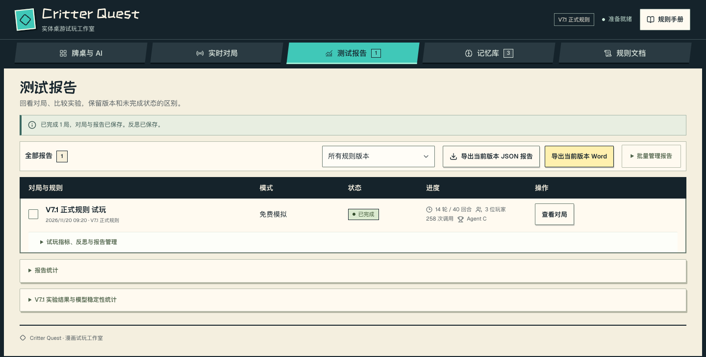

# Critter Quest Playtest Lab · V7.1

[中文](README.md) · [English](README.en.md)

Critter Quest V7.1 is a local workbench for running card-game matches with real AI models, evaluating their play, and exporting reports. Bring your own provider API key to run a real match.

The original software and UI use the [MIT License](LICENSE). The original game content has [separate noncommercial terms](GAME-CONTENT-LICENSE.md).

## Install and start

The project declares Node.js 22.13.0 as its minimum and requires npm. Installation and local startup were verified on Apple Silicon macOS with Node.js 24.20.0, npm 12.0.2, and Chrome. The first install uses the public npm registry, and initial Geist font processing may contact Google Fonts.

On the GitHub repository page, choose **Code → Download ZIP** and extract the archive, or clone the repository with Git. Run these commands from the directory containing `package.json`.

```sh
npm ci
npm run local
```

The startup command initializes a local database. If prompted to apply D1 migrations, check that the target says `local` before proceeding. Open the address shown in the terminal, normally [http://localhost:3000](http://localhost:3000). Press Ctrl+C in the terminal to stop. On macOS you can also double-click **Start.command** after installing dependencies.

## Run your first real AI match

The interface uses Chinese labels. Use the labels in parentheses to find the controls.

1. In **Table & AI (牌桌与 AI)**, enable 2–4 seats and select **API Match (API 对战 · 按供应商计费)**.
2. For each enabled seat, open **Configure Model & Memory (配置模型与记忆)**. Choose a provider, enter your **API Key**, select a model from **选择模型** or enter its ID in **模型 ID（可手动填写）**, then click **Save Configuration (保存配置)**.
3. Leave **Number of Matches (连续局数)** set to 1 and click **Start API Match (开始 API 对战)**. Follow the market, orders, and table chat in **Live Match (实时对局)**. The optional **Test Live Connection (测试真实连接)** sends one model request. Connection tests and matches can incur provider charges.
4. To stop partway through, click **Pause & Save (暂停并保存)**. After refreshing or reopening the same address, click **View & Resume (查看并继续)**, then **Resume Current Match (继续当前对局)**. Re-enter keys for any seats that prompt for one.
5. Once the completed match is saved, open **Test Reports (测试报告)** and choose **导出当前版本 JSON 报告** for JSON or **导出当前版本 Word** for Word.

Provider presets include OpenAI, Doubao, DeepSeek, Grok / xAI, and Claude / Anthropic. For another OpenAI-compatible service, select **Custom Compatible API (自定义兼容 API)** and enter the provider’s public HTTPS base URL in **API 地址（HTTPS）**. For a Doubao inference endpoint, enter the Endpoint ID from its console in the model ID field. Model availability depends on your provider account. Enter the custom API address before entering its key. If you change the endpoint, enter the key for that endpoint again.

## Keys, records, and local use

After updating, you may need to re-enter and save your API keys. Model settings and existing matches are retained. If an older match lacks a verified connection, confirm the endpoint it used before entering that endpoint’s key.

Saving a configuration stores the key in local storage for this address in the current browser. Reopening the same address with that browser can restore it. Clearing site data requires you to enter it again. Use **Clear All Saved Keys (清除所有已保存 Key)** in the seat configuration to remove saved keys. Provider requests use the corresponding key. Keep credentials out of Git, screenshots, reports, and issues. Reports and full records can contain player inputs, strategies, memories, and reflections. Open and review exports before sharing.

Local records are stored in `.wrangler/state` in the project directory. Start from a fresh clone or extraction on first use. The workbench is for one person on their own machine. Keep it on a loopback address and avoid exposing the port to your LAN or the internet. The match-record API has no sign-in or per-user isolation. Anyone who can reach the service can read or modify records.

The rule ID is `final-v7.1`. Standard mode takes three completed orders to win, and quick mode takes two. See **Rules (规则文档)** for the official text. To resume a match from an older version, use the corresponding workbench and its original data directory.

## Optional preview: free simulation without a key

In **Table & AI (牌桌与 AI)**, enable 2–4 seats, choose **Free Simulation (免费模拟 · 不调用模型)**, and click **Start Free Simulation (开始免费模拟)**. Local strategies play through the rules, and you can save, resume, and export the run to explore the table, rules, and reports. Use API Match to evaluate actual model performance.



_The screenshot shows a no-key simulation from an isolated environment._

## Licenses and attribution

- **Software and UI.** The project’s original code and UI, the confirmed geometric seat artwork, and the site icon are available under the [MIT License](LICENSE), including for commercial use. The copyright notice is `Copyright (c) 2026 JessToX`. See the [license scope](LICENSE-SCOPE.en.md).
- **Game content.** Anyone may use, copy, share, and adapt JessToX’s original V7.1 game content for noncommercial purposes. Commercial use requires separate permission from JessToX where authorization is required by law. This covers original rule text, cards, orders, crafting lists, and copies of that expression in source, snapshots, and the UI. See the [game content permission](GAME-CONTENT-LICENSE.md) and [scope](LICENSE-SCOPE.en.md#game-content).
- **Third-party material.** Fonts, templates, icons, and npm dependencies retain their upstream licenses. See the [third-party notices](docs/THIRD_PARTY.en.md).

Run `npm run check` for the full local checks. For maintenance, see the [architecture notes](docs/ARCHITECTURE.md) and [maintenance guide](docs/MAINTENANCE.md).
