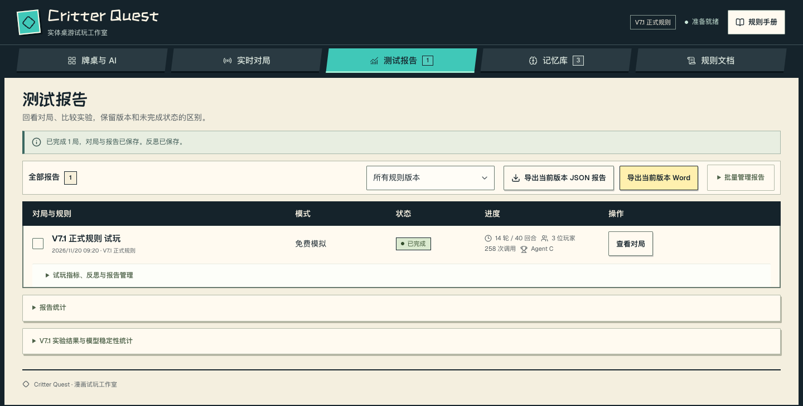

# Critter Quest Playtest Lab · V7.1

[中文](README.md) · [English](README.en.md)

Critter Quest V7.1 是一款在本机用真实 AI 模型运行卡牌对局、测试模型表现并导出报告的工作台。运行真实对局需要你自己的供应商 API Key。

原创软件与 UI 采用 [MIT](LICENSE)，原创游戏内容适用[单独的非商业许可](GAME-CONTENT-LICENSE.md)。

## 安装与启动

项目声明的最低 Node.js 版本为 22.13.0，另需 npm。安装与本机启动已在 macOS Apple Silicon 上用 Node.js 24.20.0、npm 12.0.2 和 Chrome 验证。首次安装需要访问公共 npm registry，首次处理 Geist 字体可能访问 Google Fonts。

克隆仓库或解压源码，在含有 `package.json` 的目录运行：

```sh
npm ci
npm run local
```

启动命令会初始化本地数据库。若终端询问是否应用 D1 迁移，确认目标显示为 `local` 后继续。打开终端显示的地址，默认是 [http://localhost:3000](http://localhost:3000)。结束时在终端按 Ctrl+C。macOS 用户安装依赖后也可双击 **Start.command**。

## 跑第一场真实 AI 对局

1. 在 **牌桌与 AI** 启用 2–4 个座位，选择 **API 对战 · 按供应商计费**。
2. 在每个启用的座位点 **配置模型与记忆**。选择供应商，填入自己的 **API Key**，从 **选择模型** 下拉菜单选一个模型，或填写 **模型 ID（可手动填写）**，再点 **保存配置**。
3. 保持 **连续局数** 为 1，点击 **开始 API 对战**。在 **实时对局** 查看市场、订单和桌聊。可选的 **测试真实连接** 会发起一次模型调用。真实连接测试和对局都可能产生供应商费用。
4. 中途需要停下时，点 **暂停并保存**。在同一地址重新打开或刷新后，点 **查看并继续**，再点 **继续当前对局**。如果提示缺少 Key，重新填入所需座位的 Key。
5. 对局结束并显示已保存后，进入 **测试报告**，使用 **导出当前版本 JSON 报告** 或 **导出当前版本 Word**。

供应商预设包括 OpenAI、豆包 / Doubao、DeepSeek、Grok / xAI 和 Claude / Anthropic。其他 OpenAI 兼容服务可选择 **自定义兼容 API**，在 **API 地址（HTTPS）** 填写供应商的公开 HTTPS Base URL。使用豆包推理接入点时，在模型 ID 中填写控制台里的 Endpoint ID。可用模型取决于你的供应商账户。先填自定义地址，再填写对应的 Key。更改接口后需要重新输入 Key。

## Key、记录与本机使用

升级后可能需要重新填写并保存 API Key。模型配置和旧对局记录会保留；旧局缺少可核对的连接信息时，请先确认它原来使用的接口，再输入对应 Key。

保存配置时，Key 写入当前浏览器的同源本地存储。同一浏览器打开同一个地址可重新加载，清除站点数据后需重新输入。可在座位配置里点击 **清除所有已保存 Key**。向供应商请求时会用到相应的 Key。请勿将凭据写进 Git、截图、报告或 Issue。报告与完整记录可能包含玩家输入、策略、记忆和反思，分享前请打开检查。

本机记录保存在项目目录的 `.wrangler/state`，初次使用请在新克隆或新解压的目录启动。工作台用于单人本机运行，请保持回环地址，避免把端口转发到局域网或公网。对局记录接口没有登录或按用户隔离，连接到服务的其他用户能够读取或修改记录。

规则 ID 为 `final-v7.1`。标准模式完成 3 单胜出，快速模式完成 2 单胜出。正式正文见 **规则文档**。继续旧版对局请使用对应版本的工作台和原数据目录。

## 可选体验：无 Key 免费模拟

在 **牌桌与 AI** 启用 2–4 个座位，选择 **免费模拟 · 不调用模型**，点击 **开始免费模拟**。本地策略会跑完规则流程，也可保存、恢复和导出，用于熟悉牌桌、规则与报告。真实模型表现请使用 API 对战评估。



_截图来自隔离环境中的无 Key 模拟。_

## 许可与署名

- **软件与界面。** 项目原创代码、UI 和已确认归属的几何座位图与站点图标采用 [MIT](LICENSE)，包括商用。适用范围见[许可索引](LICENSE-SCOPE.md)。版权声明为 `Copyright (c) 2026 JessToX`。
- **游戏内容。** 任何人都可出于非商业目的使用、复制、分享和改编 JessToX 拥有权利的 V7.1 原创游戏内容。商用如依法需要授权，须另获 JessToX 许可。授权涵盖原创规则正文、卡牌、订单、制作清单及这些表达在源码、数据快照和界面中的副本。[游戏内容授权正文](GAME-CONTENT-LICENSE.md) · [范围索引](LICENSE-SCOPE.md#游戏内容)
- **第三方内容。** 字体、模板、图标和 npm 依赖沿用各自上游许可。[第三方署名](docs/THIRD_PARTY.md)

本地综合检查使用 `npm run check`。维护入口见[架构说明](docs/ARCHITECTURE.md)和[维护指南](docs/MAINTENANCE.md)。
