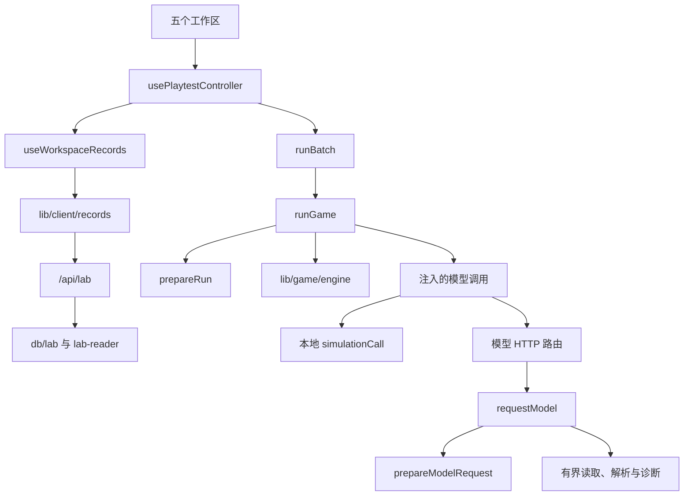

# V7.1 试玩工作台架构

- `app` 挂载工作台并处理 HTTP。五个工作区共用由 `features/workspace` 管理的配置和运行状态。各功能的展示和操作放在对应 `features` 目录。
- `lib/game/engine.ts` 导出创建游戏、回合推进、合法动作、执行动作及玩家可见状态。引擎只登记正式 V7.1。固定卡牌和订单、市场结算、事件栈、玩家视角分别在 `lib/game/engines/v71`。
- `lib/playtest` 编排实验和单局运行。调用方注入模型调用、进度更新和存档。免费模拟依据可见市场信息选动作。公开桌聊和私有决策分别构造输入。
- `lib/rules/scope.ts` 验证正式规则 ID、内置正文、来源哈希和引擎。记录接口跳过不适用的条目，向工作台报告数量。恢复入口再次校验。Word 规则上传入口会明确返回不支持。
- `lib/records` 定义编解码。D1 分页查询从同一个读快照定位记录及分片。正式 V7.1 的状态和规则快照沿用既有序列化结构。
- `lib/reports` 按同一 V7.1 状态生成界面统计、JSON 和 Word。
- `app/styles` 放共享漫画样式。四席占位图按座位编号和状态选取。座位和状态也有文本标签。

## 从界面到持久化

- 工作区控制器持有当前运行的 AbortController。终止后的总结与最后一次保存结束，才能交出运行控制权。记录 hook 管理列表、当前选择、保存失败时的快照及重试互斥。记忆变更在持久化成功后同时更新界面与运行回调所见的值。
- 新局在创建记录时写入参与席位及头像。恢复时，`lib/playtest/prepare-run.ts` 校验版本，复制输入，补齐历史字段及已发公开发言标记，并采用存档中的 API 调用上限。`run-game.ts` 负责轮次、动作执行、事件与保存顺序。报告回放可以直接读取原始快照。
- `lib/records/types.ts` 管理记录种类、允许删除的种类和每页条数。HTTP 层按原始页判断是否还有下一页，再报告跳过的旧版本条目数；浏览器按原始页大小推进偏移。D1 在一次查询中读取记录和对应修订的分片。`lib/records/codec.ts` 兼容普通 JSON 值与 gzip 封装。
- `lib/agents/model-request.ts` 处理三类供应商请求的路径、鉴权头、载荷和选项。`model.ts` 持有传输、截止时间及错误处理，并按发出请求时的方言解析响应。普通写路由共享 `app/api/request-origin.ts`；本机单步验收仍有自己更严格的来源与调用次数条件。
- 角色设置显示浏览器偏好，对局界面显示快照中的头像。缺失或退役的标识按实际席位显示几何图。素材范围见[角色美术说明](licenses/character-artwork.md)。

## 修改依赖方向

`scripts/architecture-policy.ts` 定义模块所有权和服务端专用模块。`scripts/architecture.ts` 解析引用、追踪浏览器可达路径并检查运行时循环。新增跨 feature 组合放在 workspace；更改允许的依赖时，同时在 `tests/architecture/boundaries.test.ts` 给出对应的图例。公开的引擎、模型调用和存档入口供上层调用，内部实现可以独立演进。
